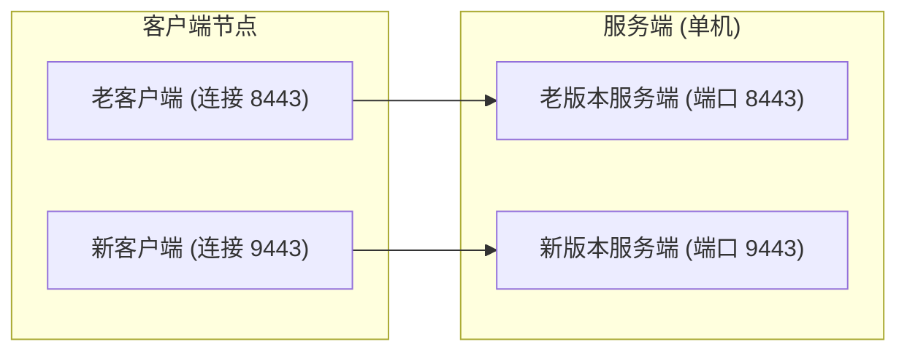

# Mirage-rs 版本兼容性矩阵与迁移指南

本文档记录 Mirage-rs 各主要版本的客户端与服务端协议兼容性矩阵，并说明跨断代版本的平滑迁移流程。

## 1. 版本兼容矩阵

| 客户端版本 \ 服务端版本 | v0.14 及更早 | v0.15.x (v0.15.0 ~ v0.15.2) | v0.15.2 之后 (含 HEAD) |
| :--- | :---: | :---: | :---: |
| **v0.14 及更早** | ✅ 互通 [^1] | ❌ 不兼容 (认证失败) | ❌ 不兼容 (认证失败) |
| **v0.15.x (v0.15.0 ~ v0.15.2)** | ❌ 不兼容 (认证失败) | ✅ 互通 | ✅ 互通 (线上协议未改) |
| **v0.15.2 之后 (含 HEAD)** | ❌ 不兼容 (认证失败) | ✅ 互通 (线上协议未改) | ✅ 互通 |

[^1]: 需注意只在同一断代内互通。Mirage 早期在 v0.3 与 v0.4 之间也曾发生过协议断代（v0.4 引入带内时间同步帧 TIME_SYNC 导致与 v0.3 客户端不兼容，详见 CHANGELOG.md）；因此「v0.14 及更早」并非全区间随意互通，跨断代版本（如 v0.3 客户端与 v0.4 服务端）不兼容。

> [!IMPORTANT]
> **关于 v0.15.2 之后的改动**：v0.15.2 之后的更新主要涉及服务端行为优化（如自校准收敛、伪装站 DNS 异步保活、反主动探测度量等），未改动线上交互协议；实测 v0.15.2 客户端与当前 HEAD 服务端双向互通完全正常。因此官方**不做** v1/v2 协议版本开关，老版本统一通过升级迁移。

## 2. v0.15 协议断代原因

v0.15.0 为彻底消除非 PFS 模式下会话重放隐患并提供严格的双向新鲜度保证，重构了握手 Token 认证与密钥派生机制（详见 [协议新鲜度与会话安全加固设计](protocol-freshness-design.md)）。由于认证报文结构与密钥派生盐（salt）的密码学定义发生改变，v0.15 起与 v0.14 及更早版本完全断代，不支持在代码层向下兼容。

## 3. 从老版本 (≤ v0.14) 平滑迁移步骤

对于生产环境或拥有较多客户端（含桌面、网关与 Android App）的部署，推荐采用**双端口并行平滑迁移**方案，确保切换期间服务零中断：



### 步骤 1：服务端并行部署新版
1. 保持当前老版本 Mirage 服务正常运行（例如老服务监听在端口 `8443`）；
2. 下载或编译新版本（≥ v0.15.0）可执行程序（如独立命名为 `mirage-rs-v15`）；
3. 复制现有服务端配置文件，将新版配置中的监听端口修改为未占用的新端口（例如 `9443`），并确保 GUI 监听端口与统计文件路径不发生冲突；
4. 启动新版本服务端进程（可作为独立 systemd 服务运行），使新老两版同时在线。

### 步骤 2：客户端逐个升级换新
1. 将各客户端（包括桌面客户端、透明网关以及 Android 客户端 App）逐个升级至最新版（≥ v0.15.0）；
2. 将升级后的客户端连接端口指向服务端的新端口（例如 `9443`）；
3. 逐台验证连接与网页浏览，确认通讯与加解密正常；
4. 老版本客户端在未升级前仍可继续连接老端口，不受影响。

### 步骤 3：停用与清理老版本服务
1. 当确认所有客户端（含所有移动端）均已成功迁移至新版后，安全停止老版本的服务进程：
   ```bash
   systemctl stop mirage-rs-server && systemctl disable mirage-rs-server
   ```
2. （可选）若希望新服务换回原端口（如 `8443`），可在停用老版本后，修改新版配置文件中的端口为原端口并重启新服务。
